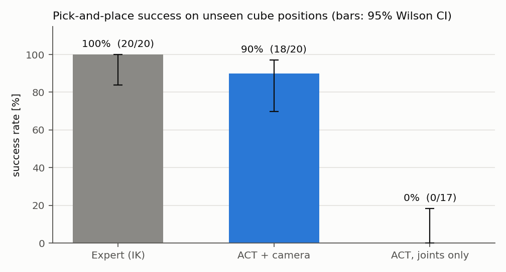
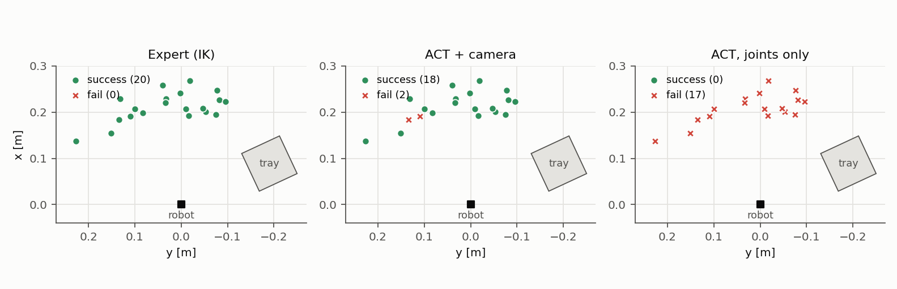
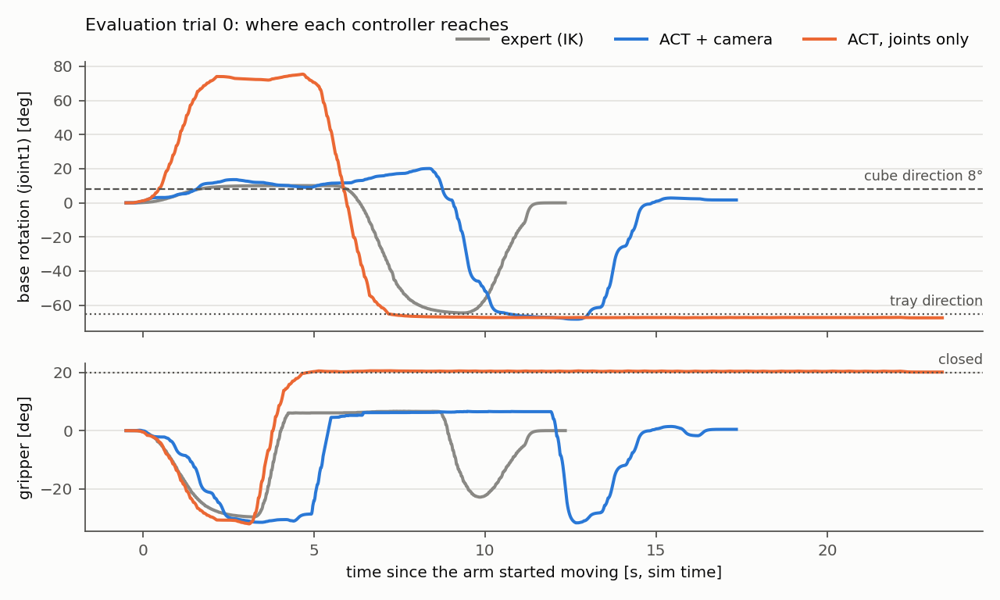

# CRANE+ V2 ビジョンピック — カメラで見て、毎回違う場所のキューブを拾う ACT

Physical AI 応用1講座 最終課題。第5回の演習（テレオペ → rosbag → LeRobot → ACT → Gazebo にデプロイ）を発展させたもの。

| | 講義のお辞儀デモ | この課題 |
|---|---|---|
| タスク | 毎回同じお辞儀 | **毎回ランダムな位置の赤いキューブ**を拾ってトレイに置く |
| 方策の入力 | 関節角のみ | 関節角 ＋ **俯瞰カメラ画像** (320×240) |
| デモ収集 | キーボードで手動テレオペ 10〜20 回 | **シミュレータの正解位置を使うお手本で自動収集**（50〜100 回） |
| 評価 | 目視 | 学習に使っていない配置で **20 回試行して成功率**、画像なし ACT・お手本と比較 |

```
            ┌──────────── データ収集（collect_demos） ─────────────┐
 Gazebo ──→ │ キューブをランダム配置 → お手本の軌道 (IK) を 20Hz で送信 │ ──→ rosbag (1 回 = 1 bag)
 (CRANE+ V2 │ → ros2 bag record → トレイに入ったか判定 → 成功だけ残す  │
  + カメラ)  └───────────────────────────────────────────────┘
                         │ rosbag2lerobot_vision.py（データ検証 → 10Hz に揃える → mp4 圧縮）
                         ▼
                 LeRobotDataset ──→ train_vision.py（ACT + ResNet18, Colab GPU）
                                              │
 Gazebo ←── 関節指令 ←── infer_vision.py ←────┘   ←── evaluate.py（/policy/enable で試行を管理、成功率を CSV に）
          画像・関節角 ──→
```

お手本は「正解のキューブ位置」（シミュレータだけが知っている特権情報）を使いますが、学習した方策が見られるのはカメラ画像と関節角だけです。つまり方策は **画像からキューブの位置を読み取る** ことを学ぶ必要があります。

---

## 結果

学習に使っていない同じ 20 通りのキューブ配置で比較しました（2026 年 10 月）。

| 条件 | 方策の入力 | 成功 / 試行 | 成功率（95% 信頼区間） | 検証 L1 誤差 |
|---|---|---|---|---|
| お手本（解析 IK） | キューブの正解位置 | 20 / 20 | 100%（84–100%） | — |
| **ACT + カメラ** | 画像 320×240 + 関節角 | **18 / 20** | **90%（70–97%）** | 0.062 |
| ACT（関節角のみ） | 関節角 | 0 / 17 | 0%（0–18%） | 0.064 |

- 2 つの ACT は検証誤差がほぼ同じなのに、実際に動かすと成功率が 90 ポイント違う（Fisher の正確確率検定 p ≈ 1×10⁻⁸）。
- 関節角のみの ACT は、キューブの位置に関係なく毎回同じ方向（約 75°）へ手を伸ばし、何もない所をつかんでトレイの上で止まる。
- 推論は CPU（エミュレーション）で 1 回約 0.8 秒かかるが、行動チャンクを 5 ステップずつ実行することで動作が成り立った。
- 学習データは 94 エピソード中、画像の抜けがあった 29 を自動で除外した 65 エピソード。





動画: （YouTube の URL）

---

## ディレクトリ構成

```
crane_vision_pick/            ROS 2 パッケージ（~/pai_ws/src に置いて colcon build）
  crane_vision_pick/
    kinematics.py             CRANE+ V2 の順・逆運動学（解析解。MoveIt 不要）
    expert.py                 お手本の軌道生成（円柱座標で補間 → IK）
    collect_demos.py          デモの自動収集（配置 → 記録 → 実行 → 成否判定）
    evaluate.py               方策 / お手本の成功率評価
    sim_check.py              環境チェック（RTF・画像 Hz・キューブ操作・お手本 1 回）
    image_downsampler.py      640x480 → 320x240 に間引く（記録量を 1/4 に）
    sim_utils.py              ign CLI でキューブを動かす / 位置を読む
    ros_io.py                 指令送信・シミュレーション時間での待機
  launch/sim.launch.py        講義の crane_plus_with_table.launch.py ＋ カメラ ＋ 専用ワールド
  worlds/pick_world.sdf       テーブル・赤/青キューブ・トレイ（外部モデル不要）
  test/                       運動学・パーサの単体テスト
training/                     pai_training の pixi 環境で動かすスクリプト
  scripts/rosbag2lerobot_vision.py   変換（画像つき・データ検証つき）
  scripts/train_vision.py            ACT 学習（入力の切り替え・検証 loss・学習曲線 CSV）
  scripts/infer_vision.py            推論ノード（/policy/enable で ON/OFF、推論時間を計測）
  scripts/debug_policy_vision.py     データ上で予測 vs 正解を比較（PNG 保存）
  scripts/plot_results.py            成功率・失敗位置マップ・学習曲線の図
  scripts/bag_to_video.py            評価 bag → 字幕つき mp4（動画素材）
  scripts/make_compare_video.py      同じ配置の評価 bag を左右に並べた比較動画
  scripts/plot_joint_traces.py       評価 bag から関節の動きを条件ごとに重ねて描く（ROS 不要）
  scripts/plot_data_quality.py       データ検証の結果（画像 Hz・抜け）の図
  configs/                           変換・学習の設定（画像あり / 画像なし）
  colab/train_on_colab.ipynb         Colab の GPU で学習するノートブック
  tests/                             Gazebo なしで変換・学習を確かめる合成データ
docs/figures/                 README とレポートの図
```

---

## 手順

前提: 第5回講義のコンテナ（`airobotbook/ros2-desktop-ai-robot-book-humble`、`pai_ros2`、`-v "$(pwd)":/workspace` 付き）と、`~/pai_training`（pixi 環境）が動いていること。以下はコンテナ内（ブラウザの `localhost:6080`）のターミナルで実行します。

### 0. 配置とビルド

```bash
cd ~/pai_ws/src
git clone https://github.com/yamamoriyohei/pai-crane-vision-pick.git   # または /workspace からコピー
cd ~/pai_ws
colcon build --symlink-install --packages-select crane_vision_pick
source install/setup.bash
```

使っている CRANE+ がカメラ付きに対応しているか確認します:

```bash
ros2 launch crane_plus_gazebo crane_plus_with_table.launch.py --show-args | grep -A1 use_camera
```

何も出なければ、新しい crane_plus（humble ブランチ）をワークスペースに入れてビルドしてください:

```bash
cd ~/pai_ws/src && git clone -b humble https://github.com/rt-net/crane_plus.git
cd ~/pai_ws && rosdep install --from-paths src --ignore-src -r -y && colcon build --symlink-install
```

### 1. シミュレータ起動と環境チェック（最初に必ず）

```bash
# ターミナル A
ros2 launch crane_vision_pick sim.launch.py
# ターミナル B
ros2 run crane_vision_pick sim_check --move
```

`ALL OK` が出れば準備完了です。表示される **RTF（実時間比）** と **画像の Hz** はレポートに使えます。カメラ画像は `~/sim_check.png` に保存されます。

### 2. デモの自動収集

```bash
ros2 run crane_vision_pick collect_demos --episodes 60
# 途中で Ctrl+C しても、もう一度実行すれば続きの番号から追加される
```

- 成功したエピソード → `~/dataset/rosbags/vision_pick/ep_XXXX/`
- 失敗したエピソード → `~/dataset/rosbags/vision_pick_failed/`（分析用）
- 全エピソードの記録 → `~/dataset/rosbags/vision_pick_log.csv`

1 エピソードはシミュレーション時間で約 12 秒です。Mac では RTF が 0.3〜0.5 程度になることが多く、60 エピソードで 30〜60 分ほどかかります。

### 3. LeRobotDataset に変換

```bash
cd ~/pai_training
pixi run python ~/pai_ws/src/pai-crane-vision-pick/training/scripts/rosbag2lerobot_vision.py \
    --config ~/pai_ws/src/pai-crane-vision-pick/training/configs/vision_conversion.yaml
# 確認（講義と同じ rerun 可視化）
pixi run python scripts/visualize_dataset.py --root /home/ubuntu/dataset/lerobot_dataset/crane_vision_pick \
    --repo-id crane_vision_pick --episode-index 0 --mode distant
```

変換前に各エピソードを検証し（画像の周波数・抜け・途切れ・長さ）、基準を外れたものは理由を表示して除外します。結果は `meta/validation_report.json` に残ります。

### 4. 学習

まず CPU で動作確認します（数分）:

```bash
pixi run python ~/pai_ws/src/pai-crane-vision-pick/training/scripts/train_vision.py \
    --config ~/pai_ws/src/pai-crane-vision-pick/training/configs/vision_train.yaml --steps 20
```

本番の学習（20,000 ステップ）は **Colab の GPU** で行います。`training/colab/train_on_colab.ipynb` を開き、セルを上から実行してください（データセットを zip にして Google Drive に置き、学習済みモデルを Drive からダウンロードする流れです）。

### 5. デプロイと評価

```bash
# ターミナル B: 推論ノード（/policy/enable を待つ）
cd ~/pai_training
pixi run python ~/pai_ws/src/pai-crane-vision-pick/training/scripts/infer_vision.py \
    --model-path /home/ubuntu/checkpoints/train/crane_vision_pick_act
# ターミナル C: 評価（学習に使っていない配置で 20 回）
ros2 run crane_vision_pick evaluate --trials 20 --label act_vision --out ~/results/eval.csv
```

推論ノードは推論時間（平均・p95）を表示します。遅い場合は `--n-action-steps 10` にすると推論回数が減ります。

### 6. 比較実験・図・動画

```bash
# お手本の成功率（上限の目安）
ros2 run crane_vision_pick evaluate --mode expert --trials 20 --label expert --out ~/results/eval.csv
# 画像なし ACT（講義と同じ入力）: configs/state_only_train.yaml で学習 → 同じく評価
ros2 run crane_vision_pick evaluate --trials 20 --label act_state_only --out ~/results/eval.csv
# 図
pixi run python ~/pai_ws/src/pai-crane-vision-pick/training/scripts/plot_results.py ~/results/eval.csv \
    --curves ~/checkpoints/train/*/training_curve.csv --out ~/results/figures
# 動画素材（評価時に --record-dir ~/dataset/eval_bags を付けておく）
pixi run python ~/pai_ws/src/pai-crane-vision-pick/training/scripts/bag_to_video.py \
    ~/dataset/eval_bags/act_vision_* --out ~/videos/act_vision.mp4
```

---

## 工夫した点（レポート用メモ）

- **特権情報を使うお手本による自動収集**: シミュレータだけが知っている正解位置で IK を解き、人手なしで多様なデモを集める。手動テレオペより速く、軌道が毎回同じ形（ACT が苦手な「多峰性」を避けられる）
- **解析 IK と安全な軌道**: CRANE+ の URDF の寸法から逆運動学を解析的に求め、FK と照合する単体テストで検証。円柱座標で補間するので、手先がテーブルに潜らない。関節速度の上限も確認
- **時刻の扱い**: Mac の Docker ではシミュレーションが実時間より遅いので、待機・記録（`--use-sim-time`）・推論をすべてシミュレーション時間で行い、RTF が変わっても学習データと実行時のタイミングがずれないようにした
- **データ量の設計（第3回）**: 640×480 のまま記録すると 1 エピソードあたり約 110 MB になる。320×240 に間引いて 1/4 にし、変換後は mp4 で保存する
- **データ検証**: 変換前に画像の Hz・抜け・途切れを検査して不良エピソードを除外。各フレームの「画像の古さ」も記録
- **関節の並び順の統一**: 講義版の変換は `/joint_states` の並び順をそのまま使い、推論ノードは別の順（joint1, 2, 4, 3）に並べ替えていた。変換・推論・評価のすべてで関節名から [joint1, joint2, joint3, joint4, gripper] に並べ替え、取り違えが起きないようにした
- **定量評価と比較実験**: 学習に使っていない配置で成功率を測り、画像なし ACT（講義と同じ入力）やお手本と比較。失敗した位置を地図に描いて弱点を分析

## テスト

```bash
cd crane_vision_pick && python3 -m pytest test/      # 運動学・軌道・パーサ
# Gazebo なしで変換〜学習〜デバッグを通す（pixi 環境で）
python training/tests/make_synthetic_bags.py --out /tmp/synth_bags
```

## ライセンス・出典

- CRANE+ V2 のモデル・寸法: [rt-net/crane_plus](https://github.com/rt-net/crane_plus)（Apache-2.0）
- 変換・学習・推論スクリプトの元: 講座の [matsuolab/pai_training](https://github.com/matsuolab/pai_training)
- 模倣学習: [LeRobot](https://github.com/huggingface/lerobot) / ACT (Zhao et al., 2023)
